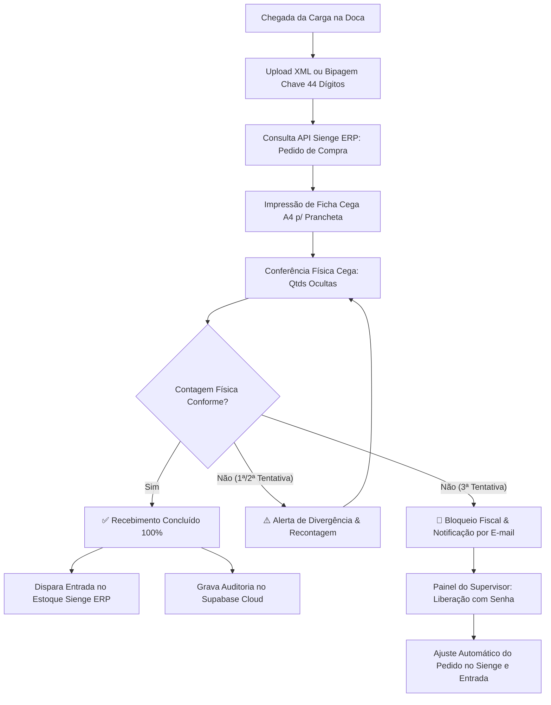

# 🚀 Omni Fiscal AI - Recebimento Cego & Sienge ERP Cloud

Sistema corporativo de **Recebimento Fiscal Inteligente com Conferência Cega**, integrado em tempo real à **API do Sienge ERP** da Omni Trade Brasil e com persistência de auditoria em **Banco de Dados Supabase (PostgreSQL Cloud)**.

---

## 🏗️ Arquitetura do Sistema



---

## 🌟 Funcionalidades Principais

1. **Bipagem e Leitura de NF-e**:
   - Leitura de chave de 44 dígitos via leitor de código de barras ou digitação.
   - Upload de arquivo `.xml` da NF-e direto no navegador (Drag & Drop) com parser nativo.
   - Varredura da pasta física de rede `XML_PENDENTES` e arquivamento automático em `XML_LIDOS`.

2. **Conferência Física Cega (Anti-Fraude)**:
   - Quantidades faturadas ficam estritamente ocultas (`[ OCULTA ]`).
   - Obriga o operador da doca a conferir as unidades reais, eliminando o vício de confirmação.

3. **Ficha Inteligente de Impressão (Prancheta / Doca)**:
   - Layout formatado em CSS Print (Folha A4) com cabeçalho, tabela para anotação a caneta, QR code e canhoto para assinatura do conferente e motorista.

4. **Regra de 3 Tentativas de Recontagem & Trava**:
   - **1ª Tentativa**: Alerta âmbar solicitando recontagem do conferente.
   - **2ª Tentativa**: Alerta laranja convocando um 2º conferente independente.
   - **3ª Tentativa**: **Bloqueio Total Vermelho** no pátio e notificação imediata ao supervisor (`claudio.guidi@omnitradebrasil.com`).

5. **Painel do Supervisor (Aprovação com Senha)**:
   - Autenticação e justificativa formal de auditoria.
   - Opção de **Ajuste Automático de Quantidades no Pedido do Sienge ERP** antes de autorizar a entrada fiscal.

6. **Persistência em Banco de Dados (Supabase PostgreSQL Cloud)**:
   - Histórico completo de conferências, itens, quantidades contadas, tentativas e decisões de supervisão.
   - Tela de consultas com filtros, cartões de métricas e exportação para CSV/Excel.

---

## ☁️ Deploy na Vercel (Serverless Edge)

O projeto está totalmente configurado para rodar na **Vercel** através de Serverless Functions:

- `/api/sienge/status`: Ping e status de conectividade live com Sienge e Supabase.
- `/api/sienge/purchase-orders`: Proxy autenticado para busca de pedidos de compra no Sienge.
- `/api/sienge/aprovar`: Execução de liberação e recálculo no Sienge.
- `/api/recebimentos/salvar`: Inserção de dados de auditoria no Supabase Cloud.
- `/api/recebimentos/listar`: Consulta ao banco de dados com filtros e paginação.
- `/api/xmls/pendentes`: Exemplos pré-carregados para testes.

### Variáveis de Ambiente Recomendadas na Vercel:
```env
SIENGE_SUBDOMAIN=omnitrade
SIENGE_USER=omnitrade-claudioguidi
SIENGE_PASS=XjPFBTCjVJ09bKA5se2C69xrIf5fEnx7
SUPABASE_URL=https://cwukvxzdzellvbcacxyj.supabase.co
SUPABASE_KEY=sb_publishable_UllsGGPZ_8e1eBN4kXyLTw_Sa8OiHML
SUPERVISOR_EMAIL=claudio.guidi@omnitradebrasil.com
```

---

## 💻 Execução Local

Para rodar localmente no Windows:
1. Dê 2 cliques no arquivo `iniciar_servidor.bat` ou execute:
```bash
node server.js
```
2. Acesse no navegador: **http://localhost:3333**

---

## 🗄️ Esquema do Banco de Dados (`schema.sql`)

O arquivo `schema.sql` contém o DDL completo para criação da tabela relacional dedicada:
- Tabela: `public.omni_recebimentos`
- Índices: Chave NF-e, Pedido Sienge, Status e Data de Criação.
- Compatibilidade nativa com Row Level Security (RLS) do Supabase.

---
**Desenvolvido para:** Omni Trade Brasil & Fortbras  
**Autor:** Claudio Guidi  
**Tecnologia:** HTML5 Vanilla • Node.js Serverless • Vercel • Supabase • Sienge ERP API v1
